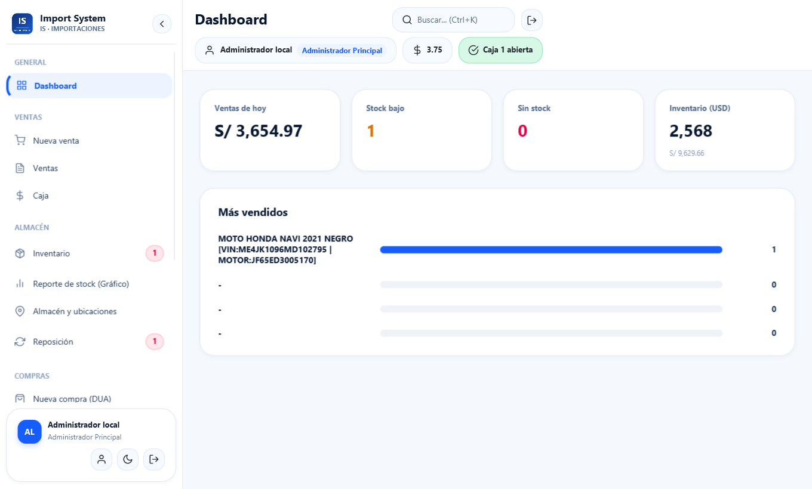
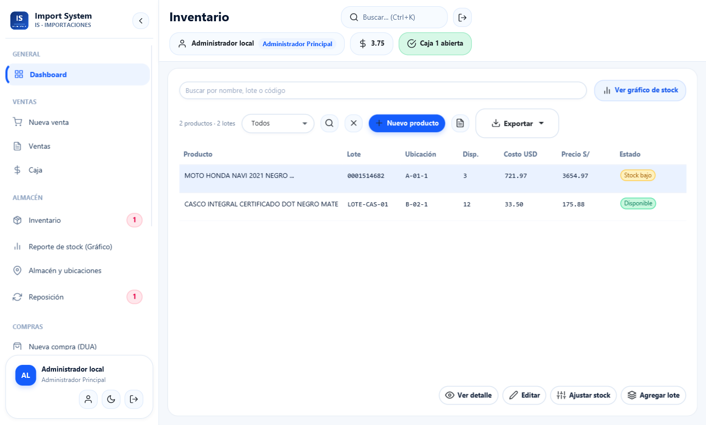
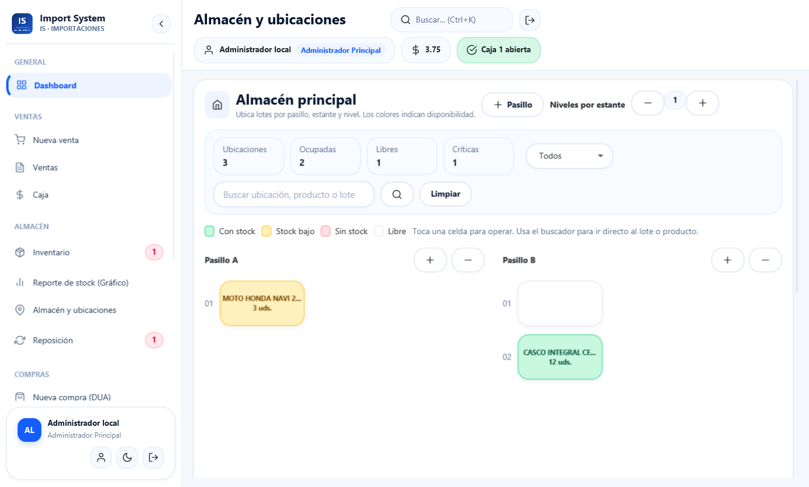
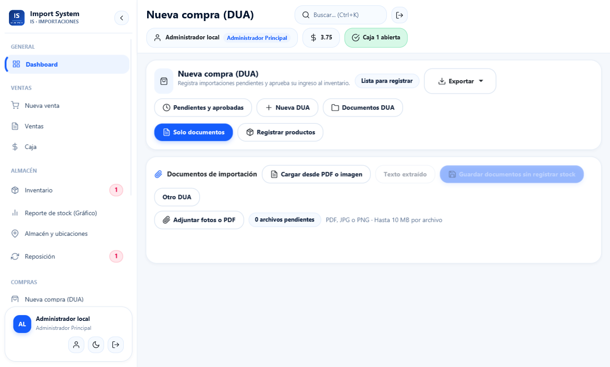

# Import System

Sistema de escritorio para gestionar importaciones, ventas, caja e inventario
por lotes. Desarrollado con **Java 17, JavaFX, Spring Boot y SQLite**.

## Descargar para Windows

### [Descargar e instalar — Import_System_Setup.exe](https://github.com/DEIVISBRYAN/Import_System/releases/latest/download/Import_System_Setup.exe)

1. Descarga el instalador y ábrelo.
2. Pulsa **Siguiente**, elige la carpeta y pulsa **Instalar**.
3. Pulsa **Finalizar** y abre Import System desde el Escritorio o el Menú Inicio.

Incluye Java y SQLite; no requiere IntelliJ, Maven ni un servidor de base de
datos para usarlo. La instalación es por usuario y añade un desinstalador.
El archivo no cuenta con firma digital de editor.

| Alternativa | Descarga |
| --- | --- |
| Portable ZIP | [Descargar ZIP](https://github.com/DEIVISBRYAN/Import_System/releases/latest/download/Import_System_Windows_Portable.zip) |
| Portable TAR.GZ | [Descargar TAR.GZ](https://github.com/DEIVISBRYAN/Import_System/releases/latest/download/Import_System_Windows_Portable.tar.gz) |
| Todas las versiones | [Releases](https://github.com/DEIVISBRYAN/Import_System/releases) |

Los portables también son para **Windows de 64 bits**. Extrae toda la carpeta;
conserva `app` y `runtime` junto a `GestionImportaciones.exe`.
Los enlaces ZIP/TAR del botón **Code** contienen el código fuente.

## Usuarios de prueba

La descarga Windows incluye estas cuentas de demostración:

| Usuario | Contraseña | Rol |
| --- | --- | --- |
| `admin.demo` | `Demo12345` | Administrador |
| `gerente.demo` | `Demo12345` | Gerente |
| `cajero.demo` | `Demo12345` | Cajero |
| `almacen.demo` | `Demo12345` | Almacenero |
| `contador.demo` | `Demo12345` | Contador |

El login muestra el acceso de prueba. Al actualizar se añaden las cuentas
faltantes, sin cambiar claves ni datos de usuarios existentes. Si ya cambiaste
la contraseña de una cuenta demo, conserva esa contraseña.

## Qué puedes hacer

| Módulo | Funciones |
| --- | --- |
| Ventas y caja | Productos por código o lector USB, clientes, pagos, historial, apertura, arqueo y cierre. |
| Inventario | Lotes FIFO, ajustes de stock, mínimos, reportes y ubicación en el almacén. |
| Compras | Proveedores, reposición, pedidos y recepción completa. |
| DUA / DAM | Adjuntos PDF e imágenes, lectura y revisión antes de aprobar el ingreso al stock. |
| Comprobantes | PDF, impresión térmica de 80 mm y seguimiento de pendientes. |
| Motos | Identificación por VIN y motor; expedientes internos de inscripción y transferencia. |
| Reportes y accesos | Exportaciones PDF, Excel o CSV; usuarios, roles y perfil. |

## Vistas del sistema

Capturas de referencia con datos de demostración.

**Dashboard:** resumen de ventas, disponibilidad y productos con mayor salida.



**Inventario:** consulta de productos, lotes, costos y estado de las existencias.



**Almacén:** mapa de ubicaciones con cantidades y colores de disponibilidad.



**Compras DUA:** documentos y revisión de ingresos antes de afectar al stock.



## Código y SQL

- [Código Java](src/main/java/)
- [Vistas FXML](src/main/resources/view/)
- [Estilos](src/main/resources/css/)
- [SQL de SQLite](src/main/resources/db/sqlite/V1__esquema_local_completo.sql)
- [Pruebas](src/test/java/)
- [Generador del instalador](scripts/crear-instalador.ps1)

La base SQLite se crea y actualiza con Flyway al iniciar. Los registros se
guardan en `%APPDATA%/GestionImportaciones/sistema.db`, fuera del programa.
Sin el modo de prueba, una base nueva indica dónde consultar la clave inicial privada.
Actualizar o desinstalar el programa conserva los datos locales.

Para desarrollar, instala JDK 17 y Maven:

```powershell
git clone https://github.com/DEIVISBRYAN/Import_System.git
cd Import_System
mvn test
mvn package
java -jar target/crud-persona-spring-1.0.0.jar --app.demo.users=true
```

Para regenerar la entrega Windows:

```powershell
.\scripts\crear-instalador.ps1 -JavaHome $env:JAVA_HOME
```

## Alcance

SQLite funciona localmente en una computadora; no compartas el archivo por
red para operar varias cajas. El tipo de cambio se ingresa manualmente.
Los PDF no acreditan aceptación de SUNAT y el seguimiento SUNARP no presenta
trámites oficiales. Revisa los datos extraídos de cada DUA antes de aprobar.

**Equipo:** Deivis Brayan Qusipe Pacompia (DBQP), Rsaquel Pamela Laura Ccama
(RPLC) y Elyan Rosy Quispe Zapana (ERQZ).
